<p align="center"></p>

# ZeniField · 현장·매장 운영관리


**현장 방문 보고를 AI 비서 '제니에리'가 읽고, 직급마다 "지금 어디에 무슨 일이 있고, 나는 무엇을 하면 되는지"를 알려 주는 현장 운영 앱입니다.**

<br clear="left">

- 방문 일정 → 방문·조치(결과와 후속 조치) → 활동 요약이 한 흐름으로 이어져요.
- 모든 화면 맨 위에서 제니에리가 그 화면의 할 일을 먼저 정리하고, 줄마다 바로 하기 버튼과 보낼 말 복사를 붙여요.
- 모든 직급이 같은 메뉴를 보고, 보이는 범위만 직급(잡매니저·파트장·팀장·사업부장)에 따라 달라요.

## 목차

1. [핵심 철학](#핵심-철학)
2. [핵심 기능](#핵심-기능)
3. [화면으로 보기](#화면으로-보기)
4. [처음 버전과 달라진 점](#처음-버전과-달라진-점)
5. [시작하기](#시작하기)
6. [메뉴별 사용 안내](#메뉴별-사용-안내)
7. [개발자 안내](#개발자-안내)
8. [문서 모음](#문서-모음)

## 핵심 철학


1. **보는 데서 끝나지 않고 바로 한다.** 화면마다 제니에리가 할 일을 먼저 말하고, 줄마다 `일정 잡기`·`작성`·`조치` 같은 바로 하기 버튼과 받는 사람에게 보낼 말을 붙여요.
2. **사람이 아니라 일에 대해 말한다.** "누가 못했다"가 아니라 "어느 현장의 무엇이 남았다"로 써요. 순위·낙인·빨간 경보를 늘리지 않고, 비교는 자기 지난주와만 해요.
3. **판단은 기록에서, 결정은 사람이.** 코드는 사실(기한·회차·마지막 방문)만 계산해요. "바로 확인·조치 필요" 같은 판정은 입력할 때 AI가 제안하고 사람이 확인해 저장한 것만 써요. 임계값·키워드로 추정하지 않아요.
4. **AI는 비서다.** 제니에리는 정리·제안·초안을 맡고, AI가 안 되어도 같은 칸의 규칙 정리로 업무가 멈추지 않아요. 선택지는 같은 무게로 보여 주고 추천을 강요하지 않아요.
5. **결론 먼저, 한 화면에 한 번.** 무슨 일 → 어디에 → 할 일 순서로, 같은 숫자·목록을 두 곳에 두지 않아요.
6. **모두 같은 화면, 범위만 다르게.** 잡매니저부터 사업부장까지 같은 메뉴·같은 구성을 보고, 직급에 따라 보이는 범위와 호칭만 달라져요.
7. **개인정보는 보내지 않는다.** AI에는 보고 본문과 사실만 보내고 이름·연락처는 빼요.

## 핵심 기능

### 1. 보고를 읽는 AI 브리핑
- **좋아지는 것:** 수백 건 보고를 읽지 않아도 "무슨 일 → 어디에 → 내가 할 일"을 1분 안에 파악해요.
- **구현:** 보고 본문·저장된 판정·문제 지도를 AI에 보내 정해진 칸 구조로 받아요(`brief-shape.ts`). 집계 숫자는 보내지 않고, AI가 안 되면 같은 칸의 규칙 브리핑으로 대신해요.

### 2. 직급별로 다른 말
- **좋아지는 것:** 잡매니저는 다음 방문, 파트장은 잡매니저 지원, 팀장·사업부장은 조직 단위 판단만 봐요.
- **구현:** 브리핑 입력에 직급과 보는 범위(`scopeUnits`)를 실어 초점·호칭·받는 사람을 바꿔요. 저장본은 사용자·직급별로 따로 둬요.

### 3. 입력하는 순간의 AI 종합 판정
- **좋아지는 것:** 보고마다 정상·지켜보기·조치 필요·바로 확인이 사람 확인을 거쳐 남아, 감이 아닌 기록으로 우선순위를 정해요.
- **구현:** 저장할 때 그 현장의 이전 보고·조치·기한으로 판정하고, 사람이 확인·수정한 뒤 저장해요. 코드는 판정하지 않아요(임계값·키워드 금지).

### 4. 말·사진·손글씨로 기록
- **좋아지는 것:** 현장에서 말하거나 회의록을 찍으면 결과·일정 초안이 채워져 기록 누락이 줄어요.
- **구현:** AI 간편 등록(음성·이미지), 읽지 못한 항목 따로 표시, 회의록 양식 인식(참석자 이름은 저장 안 함), 반복 말 정리.

### 5. 다음 방문 추천과 바로 하기
- **좋아지는 것:** 일정을 잡을 때 먼저 가 볼 곳·확인할 것·같은 날 함께 갈 곳을 바로 제안하고, 버튼 하나로 등록까지 이어져요.
- **구현:** 기한 지난 회차·기한 넘긴 조치·60일+ 미방문 같은 사실과 저장된 판정만으로 고르고(`status.ts`), 날짜 후보는 `schedule.ts`가 계산해요. 점수·순위는 쓰지 않아요.

### 6. 현장 친화적인 표현과 안전한 운영
- **좋아지는 것:** 순위·낙인 대신 할 일과 자기 과거 비교로 말해 현장 반발 없이 실행률을 높이고, 공용 운영 DB를 안전하게 바꿔요.
- **구현:** 문구 기준(과업 주어·꼬리표 금지·빨강은 기한 넘김만, 근거 `docs/briefing-research.md`). 서버 게이트웨이 검증, main 푸시 → 검증 → DB 이관 → 서버 함수 → 화면 자동 배포, 데모는 저장하지 않아요.

## 화면으로 보기

데모 데이터, PC 1280px와 모바일 390px 화면이에요. `npm run screenshots`로 다시 찍어요([캡처 방법](docs/local-development.md#매뉴얼-화면-캡처)).

### 운영 현황
제니에리 말풍선(오늘·이번 주·챙길 것) → 브리핑(무슨 일 → 어디에 무엇이 → 이렇게 챙겨 보세요) → 지표·차트.

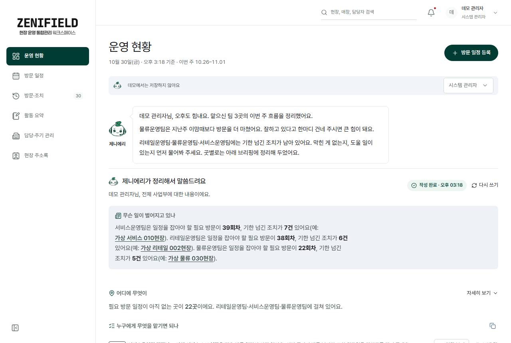 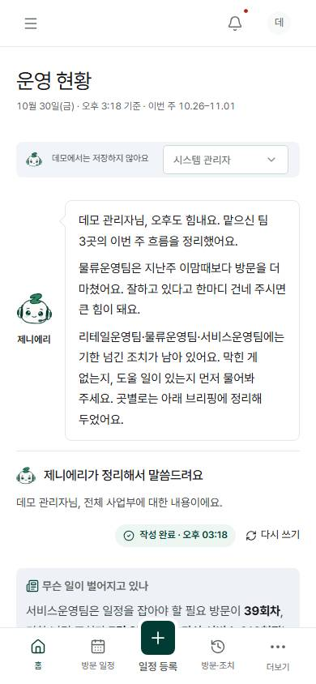

### 방문 일정
이번 주 일정·일정 잡을 회차를 정리하고, 먼저 일정 잡을 곳에 `일정 잡기`를 붙여요.

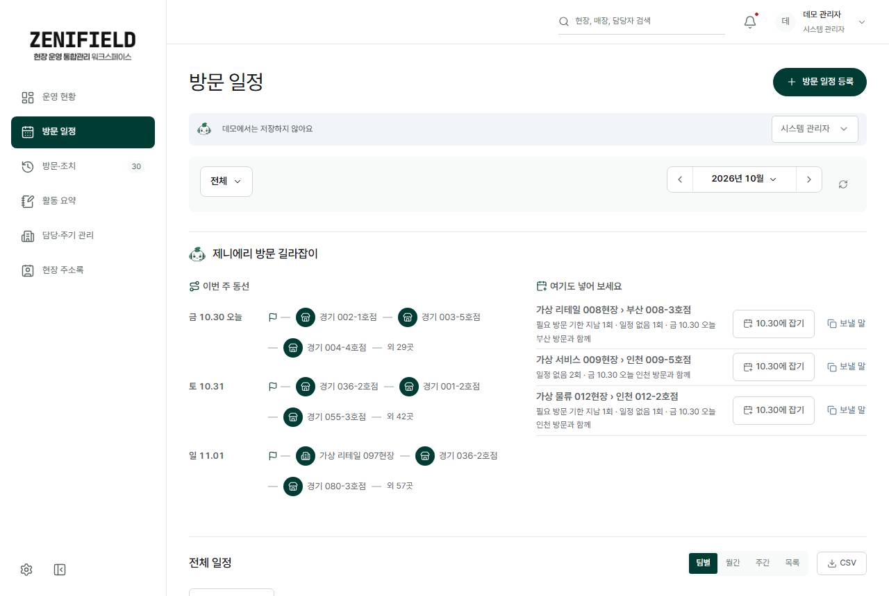 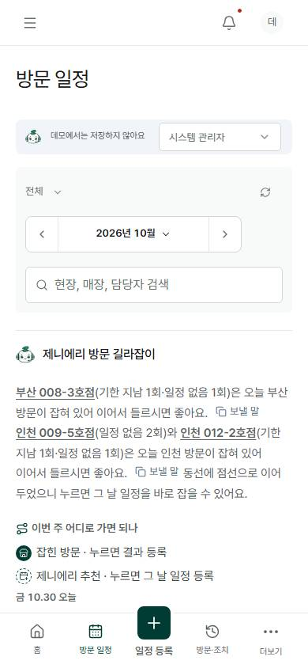

### 방문 일정 등록
제니에리가 먼저 가 볼 곳 5곳을 골라 주고(왜·주기·확인할 것·같은 날 함께), 고르면 날짜 후보로 이어져요.

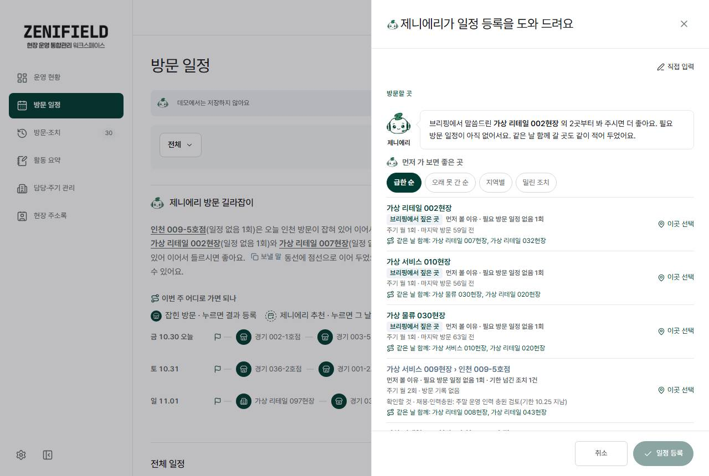 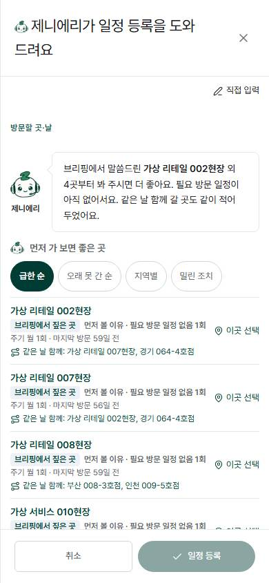

### 방문·조치
방문 기록과 후속 조치를 한 화면에서 봐요. 결과 안 쓴 방문·기한 넘긴 조치 정리 → 탭(방문 │ 조치) → 방문 아래 그 방문의 조치.

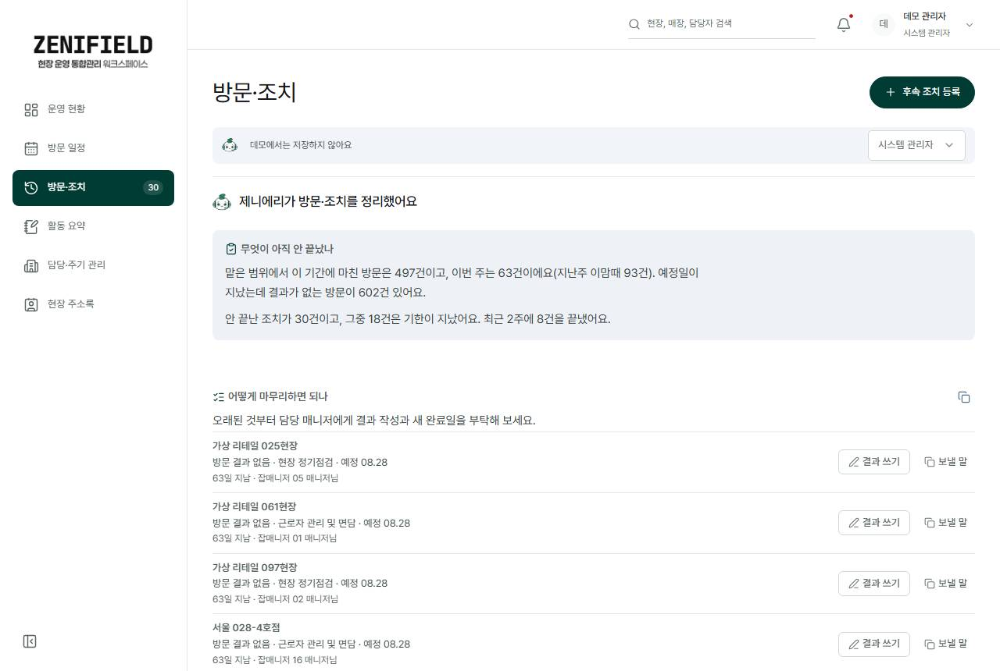 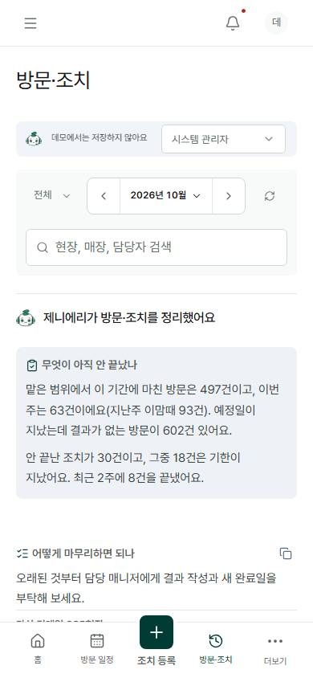

### 활동 요약
기간 브리핑과 날짜별 방문 타임라인이에요.

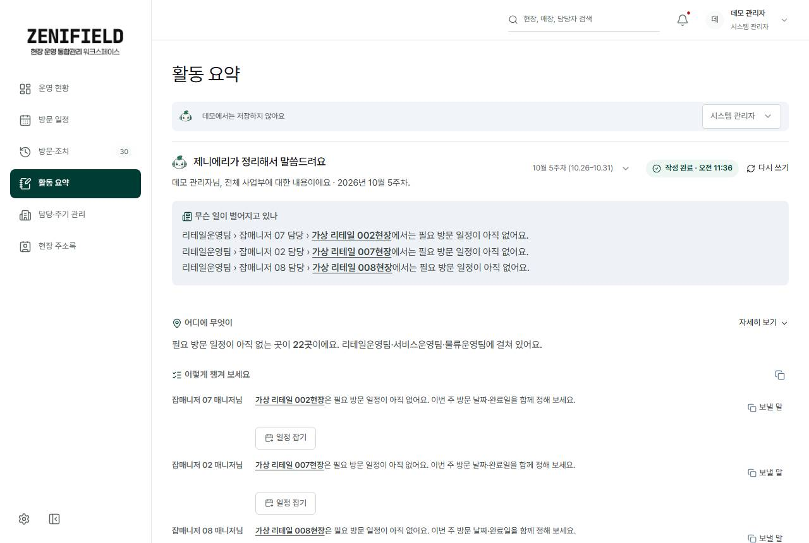 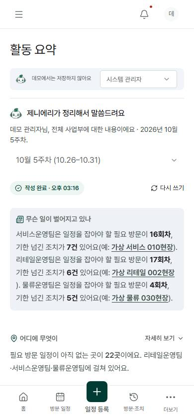

### 담당·주기 관리
담당 없는 곳·60일+ 미방문을 정리하고 `담당 정하기`·`일정 잡기`를 붙여요.

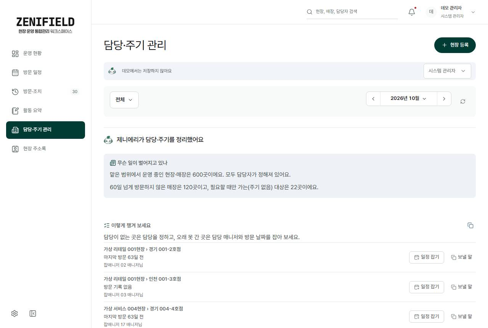 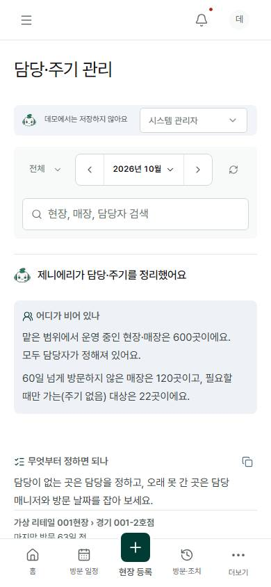

### 현장 주소록
주소·담당을 검색해요.

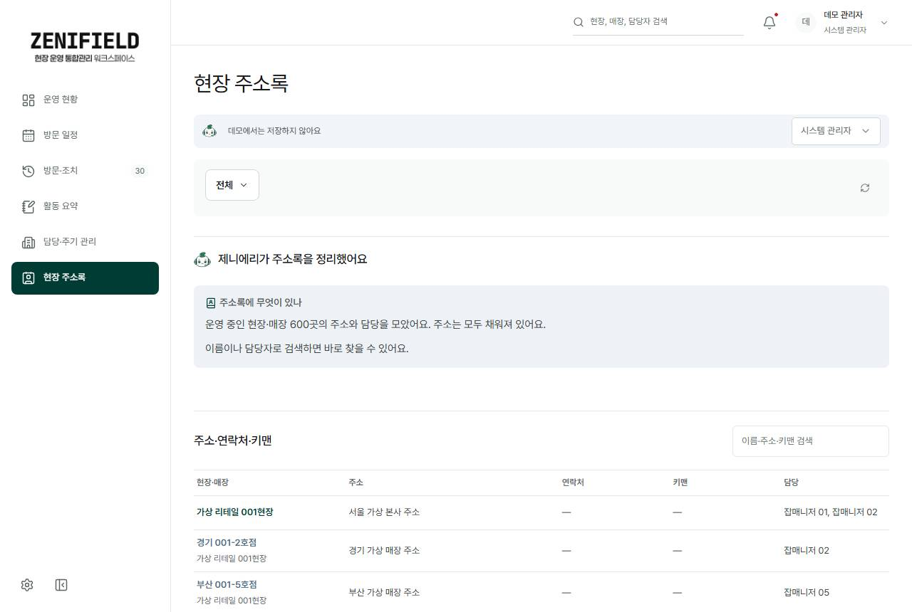 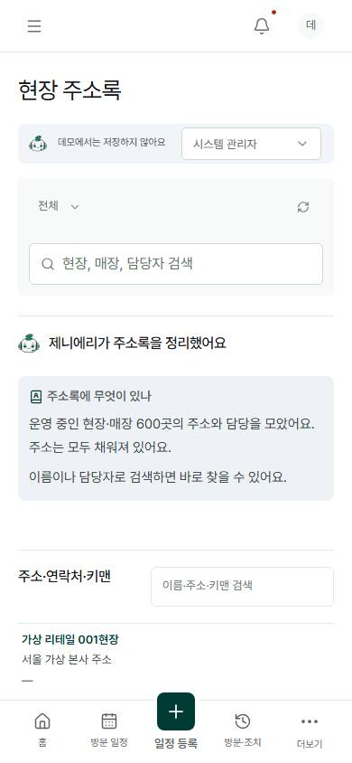

## 처음 버전과 달라진 점

2026-10-27 첫 버전 → 2026-10-30

- **브리핑:** 원문 발췌 목록 → 제니에리가 무슨 일·어디에·할 일로 정리
- **판정:** 화면이 키워드·임계값으로 추정 → 입력 때 AI 판정을 사람이 확인해 저장
- **입력:** 직접 입력 폼 → AI 간편 등록(말·사진·회의록) + 직접 입력
- **일정:** 빈칸에서 시작 → 먼저 가 볼 곳 추천 + 빈 날 + 후보 날짜
- **방문·조치:** 메뉴 둘로 나뉨 → 한 화면, 방문 아래 그 방문의 조치
- **차트:** 여러 개 + 통계·보고서 메뉴 → 차트 한 쌍(조직 공백표·이행률 꺾은선)
- **배포:** 로컬·D1 중심 → 운영 Supabase + Cloudflare Worker 자동 배포

## 시작하기

필요한 것: Node.js 22.13.0 이상, pnpm 11.25.0, Git, 브라우저.

```bash
npm run setup   # Node 검사·pnpm·의존성·Git 훅·.env 예시
pnpm dev        # http://127.0.0.1:5173  (데모: /?mode=demo)
```

- 백그라운드 서버: `npm start` · `npm stop` · `npm restart` · `npm run status`
- 검사: `pnpm typecheck` · `pnpm test`
- 매뉴얼 화면 캡처: `npm run screenshots -- --url <서버 주소>`
- 자세한 설치·설정: [로컬 개발 가이드](docs/local-development.md)
- **주의:** main 푸시는 운영 자동 배포를 실행해요([supabase-deploy](.github/workflows/supabase-deploy.yml)).

## 메뉴별 사용 안내

| 메뉴 | 하는 일 |
| --- | --- |
| [운영 현황](docs/user-guide.md#운영-현황) | 제니에리 말풍선·브리핑·지표·차트 |
| [방문 일정](docs/user-guide.md#방문-일정) | 달력·먼저 가 볼 곳 추천·일정 등록 |
| [방문·조치](docs/user-guide.md#방문-기록) | 방문 결과·후속 조치 한 화면 |
| [활동 요약](docs/user-guide.md#주차별-활동-요약) | 기간 브리핑·날짜별 타임라인 |
| [담당·주기 관리](docs/user-guide.md#현장매장-관리) | 현장·매장·담당·방문 주기 |
| 현장 주소록 | 주소·담당 검색 |
| [설정](docs/user-guide.md#설정) (사이드바 아래 아이콘) | 사용자·도메인·권한·브리핑 요소 |

관리자 업무는 [관리자 가이드](docs/admin-guide.md)를 봐 주세요.

## 개발자 안내

- **먼저 읽기:** [AGENTS](AGENTS.md) → [프로젝트 룰](PROJECT_RULE.md) → [디자인 지침](docs/DESIGN-zenielfield.md)
- **기술:** React 19 · Next.js 16 API 구조를 Vinext/Vite · Cloudflare Workers로 실행, 운영 데이터는 Supabase

| 경로 | 역할 |
| --- | --- |
| `app/platform/` | 화면·권한·회차·저장 검증·AI·일정·상태 공통 모듈 |
| `app/api/` · `lib/` · `worker/` | API·인증 어댑터·Worker 진입 |
| `supabase/` | 스키마·이관·Edge 함수 |
| `data/` · `seed/` | 원본 자료·데모 시드 |
| `scripts/` · `tests/` | 실행·번들·운영 도구·검증 |
| `docs/` | 가이드·지침·계획·현황 |

- **환경변수:** [.env.example](.env.example) — 운영 연결(`ZENIFIELD_SUPABASE_URL`·`ZENIFIELD_GATEWAY_TOKEN`), 인증(`ZENIFIELD_AUTH_PROVIDER`), AI(`OPENAI_API_KEY`·`OPENAI_MODEL`). 비밀값은 문서·커밋에 남기지 않아요.
- **배포 순서:** DB 이관 → 서버 검증 로직 번들 → Edge 함수 → 화면. 운영 DB·Edge·계정은 승인 후에만([운영 인계](docs/infrastructure.md)).

## 문서 모음

- **현황:** [기능 현황](docs/feature-status.md) · [남은 이슈](docs/next-issues-plan.md) · [디자인 이력](docs/design-history.md)
- **사용:** [사용자 가이드](docs/user-guide.md) · [관리자 가이드](docs/admin-guide.md) · [시연 안내](docs/archive/demo-walkthrough.md)
- **설계:** [방문·조치 한 화면](docs/visit-action-unify-plan.md) · [브리핑 근거](docs/briefing-research.md) · [방문 워크플로](docs/visit-workflow.md) · [AI 간편 등록](docs/archive/ai-quick-entry-plan.md) · [개발 계획 v2](docs/archive/repo-dev-plan-v2.md)
- **운영:** [Supabase 인계](docs/infrastructure.md) · [Cloudflare 이관](docs/infrastructure.md) · [데모 시드](docs/infrastructure.md)
- **이전 기록:** [이전 README 원문](docs/archive/readme-archive.md) · [문서 점검 보고서](docs/archive/documentation-audit-2026-10-29.md) · 그 밖의 계획 문서는 `docs/` 폴더
