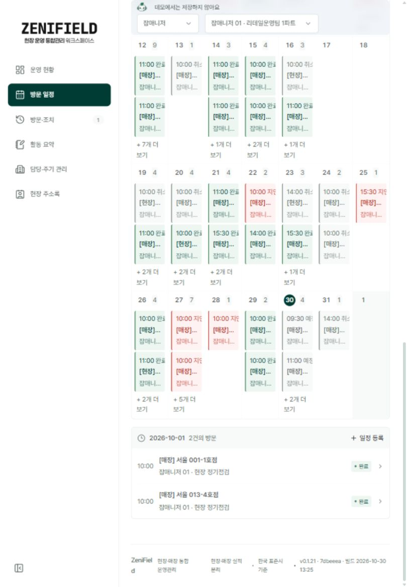
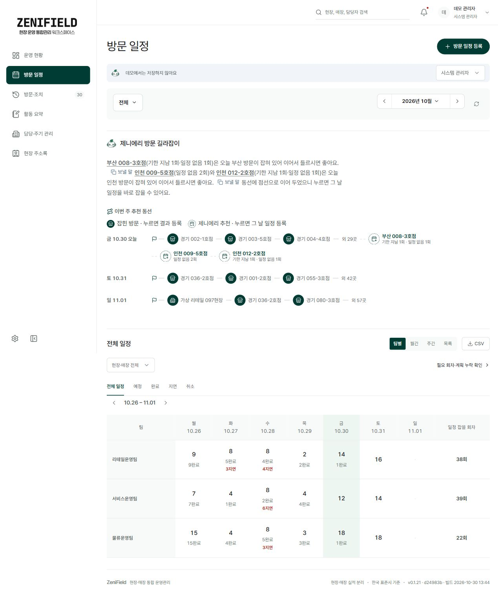
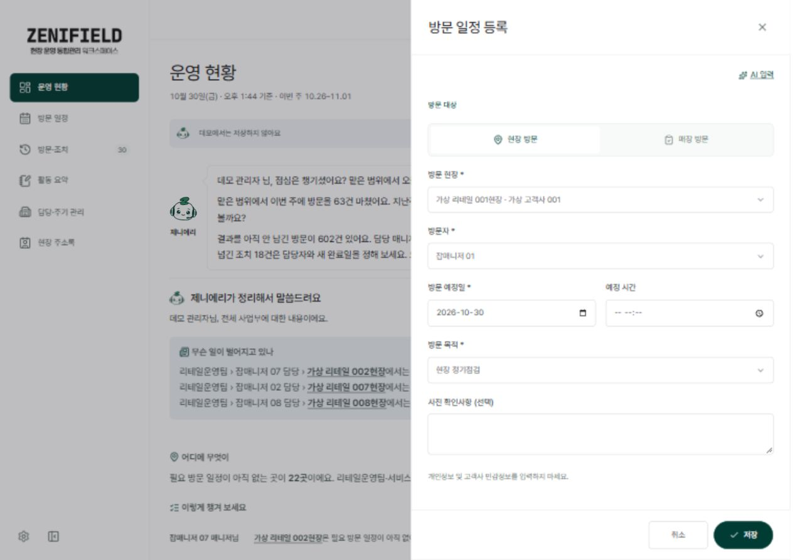
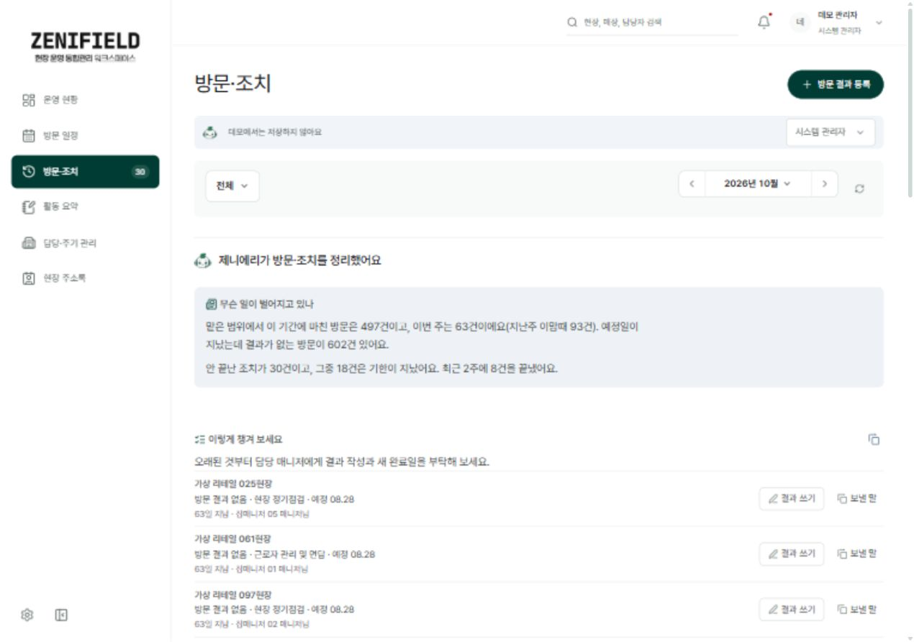
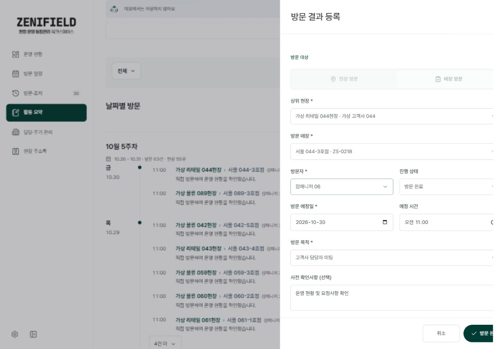
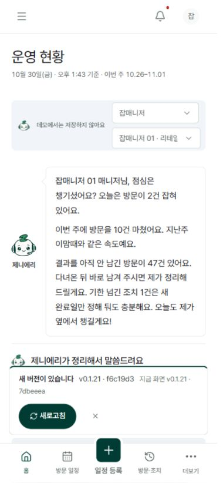
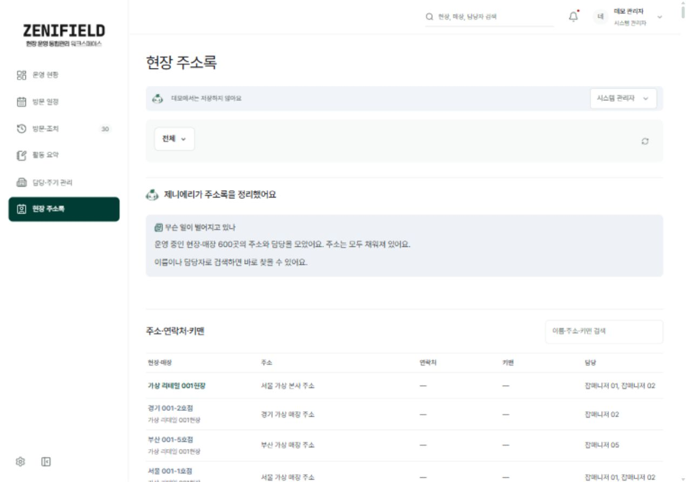
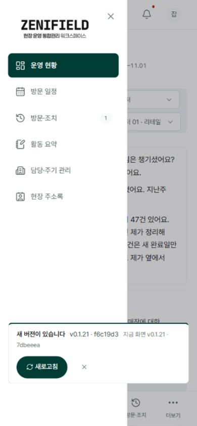

# ZeniField 사용자 테스트 수정 요청

검토일: 2026-10-30 KST. 대상: https://zenifield.jobsky.workers.dev/ 의 로그인 없는 데모.

## 결론

날짜 선택·월 경계 일정·임의 대상 선택을 우선 수정한다. UX-01~03은 업무 정확성 관련 P1, UX-04~08은 사용성 P2, UX-09는 알림 배치 P3다. 총 9건이며 별도 재검증 항목 1건이 있다.

## 범위와 증거

- 주 검증 빌드: v0.1.21 / 7dbeeea / 2026-10-30 13:25.
- 일부 재검증 빌드: v0.1.21 / d24983b / 13:44. UX-02·03·04 확인.
- 테스트 중 f6c19d3 및 이후 95f80a2 새 버전 알림 관찰. 95f80a2 전체 회귀 미수행.
- 인앱 브라우저 실제 클릭·입력·검색·역할 전환. 관리자와 잡매니저 01. 1280×900, 820×1180, 390×844.
- 모든 화면은 가상 데이터. 운영 로그인·실제 DB 저장·삭제·메일 발송·실제 AI 호출·권한 보안 검증은 미수행.
- 200% 확대, 모든 역할, 모든 상태, CSV 내용, 네트워크 실패, 중복 저장, 장치별 실기 테스트는 미수행.
- UI 소스 변경·커밋·푸시·배포 없음. 요청 목록은 검토안이며 디자인 정본 변경 아님.

## 실제 메뉴 구조

```text
ZeniField
├─ 운영 현황
├─ 방문 일정
│  ├─ 팀별(관리자) / 월간(잡매니저) / 주간 / 목록
│  ├─ 필요 회차·계획 누락 확인
│  └─ 일정 등록 → AI 입력 / 직접 입력
├─ 방문·조치
│  ├─ 안 끝난 조치 / 기한 넘긴 조치 / 완료 조치
│  └─ 전체(완료 방문) / 결과 안 쓴 방문
├─ 활동 요약 → 날짜별 방문 → 방문 결과
├─ 담당·주기 관리 → 현장 / 산하 매장
├─ 현장 주소록 → 주소·연락처·키맨·담당 검색
└─ 설정(관리자 관찰) → 브리핑 / 도메인 / 사용자·조직·권한
모바일 하단: 홈 / 방문 일정 / 일정 등록 / 방문·조치 / 더보기
```

실제 화면은 방문 기록·후속 조치를 방문·조치로 통합했고 잡매니저도 운영 현황 제목을 사용한다. 로컬 지침의 이전 메뉴명과 다르므로 작업 전 최신 제품 결정을 확인한다. 임의로 이전 구조로 되돌리지 않는다.

## 수정 요청 목록

|ID|우선순위|분류|요청|확인 빌드|
|---|---|---|---|---|
|UX-01|P1|재현 확인|인접 월 선택 날짜 오류|7dbeeea|
|UX-02|P1|재현 확인|주간 일정의 월 경계 누락|7dbeeea·d24983b|
|UX-03|P1|재현 확인|직접 입력의 임의 현장 선택|7dbeeea·d24983b|
|UX-04|P2|개선 제안|전체 탭의 의미 명확화|d24983b|
|UX-05|P2|개선 제안|완료 기록 조회와 수정 구분|7dbeeea|
|UX-06|P2|개선 제안|모바일 방문 기록 접근 개선|7dbeeea|
|UX-07|P2|개선 제안|태블릿 월간 달력 가독성|7dbeeea|
|UX-08|P2|개선 제안|주소록 빈 정보 안내|7dbeeea|
|UX-09|P3|개선 제안|새 버전 알림의 겹침 개선|7dbeeea|

## UX-01 인접 월 선택 날짜 오류

- 우선순위: P1 / 재현 확인 / 빌드 7dbeeea
- 관찰: 방문 일정의 10월 달력에서 11월 1일을 선택하면 상세가 2026-10-01과 방문 2건으로 표시됐습니다. 다음 달로 이동한 뒤에는 11월 1일 방문 3건이 표시됩니다.
- 재현: 잡매니저 01 → 방문 일정 → 10월 월간 달력 마지막 칸 11월 1일 선택 → 상세 날짜 확인 → 다음 달 이동과 비교.
- 수정 요청: 선택한 날짜의 연·월·일을 그대로 유지하고 달력 강조, 상세 목록, 신규 등록 날짜를 일치시켜 주세요.
- 완료 기준: 11월 1일 선택 시 상세와 등록 기본일 모두 2026-11-01. 9월 말·12월 말·윤년에도 같은 기준을 통과.
- 근거 화면: [캡처](screenshots/17-tablet-boundary.jpg)




## UX-02 주간 일정의 월 경계 누락

- 우선순위: P1 / 재현 확인 / 빌드 7dbeeea·d24983b
- 관찰: 관리자 추천 동선에는 11월 1일 일정 3곳과 외 57곳이 보이지만, 같은 화면 팀별 주간표의 11월 1일 열은 모든 팀이 점으로 표시됩니다.
- 재현: 시스템 관리자 → 방문 일정 → 조회 기간 2026년 10월 → 팀별 보기 10.26–11.01 → 추천 동선과 일요일 열 비교.
- 수정 요청: 주간표는 표시한 7일 전체를 조회하거나, 월 필터 밖 날짜를 조회 제외로 분명하게 구분해 주세요. 빈 일정처럼 표시하면 안 됩니다.
- 완료 기준: 추천 동선과 주간표를 동일 범위로 맞췄을 때 날짜별 합계 일치. 범위 제외와 실제 0건 구분.
- 근거 화면: [캡처](screenshots/21-schedule-full.jpg)




## UX-03 직접 입력의 임의 현장 선택

- 우선순위: P1 / 재현 확인 / 빌드 7dbeeea·d24983b
- 관찰: 일정 등록에서 대상을 고르지 않고 직접 입력으로 전환하면 가상 리테일 001현장과 잡매니저 01이 자동 선택되고 저장 버튼이 활성화됩니다.
- 재현: 시스템 관리자 → 방문 일정 등록 → 현장 미선택 유지 → 직접 입력 → 현장·방문자·저장 버튼 확인.
- 수정 요청: 대상 미선택 상태를 유지해 주세요. 사용자가 선택한 대상만 다음 입력 방식으로 넘기고, 대상 확인 전 저장을 막아 주세요.
- 완료 기준: 미선택 전환 시 빈 대상 유지. 명시적으로 선택한 대상·날짜는 AI/직접 전환을 왕복해도 보존.
- 근거 화면: [캡처](screenshots/20-latest-direct.jpg)




## UX-04 전체 탭의 의미 명확화

- 우선순위: P2 / 개선 제안 / 빌드 d24983b
- 관찰: 방문·조치의 전체 497 탭은 완료 방문 목록입니다. 결과 안 쓴 방문은 602건으로 별도 표시돼 전체라는 이름만으로 범위를 이해하기 어렵습니다.
- 재현: 시스템 관리자 → 방문·조치 → 전체 497 → 완료 방문 목록과 결과 안 쓴 방문 602 비교.
- 수정 요청: 전체를 완료 방문 또는 방문 기록으로 바꾸고, 방문과 조치 탭을 의미별로 구분해 주세요. 건수는 현재 탭 집계 대상을 표현해야 합니다.
- 완료 기준: 처음 사용한 사람이 탭 이름만 보고 완료 방문·미작성 방문·후속 조치를 구분. 조회 기간 적용 범위도 한 줄로 확인.
- 근거 화면: [캡처](screenshots/22-all-latest.jpg)




## UX-05 완료 기록 조회와 수정 구분

- 우선순위: P2 / 개선 제안 / 빌드 7dbeeea
- 관찰: 활동 요약에서 완료된 방문을 열면 방문 결과 등록이라는 제목의 편집 창과 방문 완료 버튼이 나타납니다. 기록 열람인지 신규 등록인지 혼동할 수 있습니다.
- 재현: 활동 요약 → 10월 5주차 → 10.30 11:00 서울 044-3호점 방문 결과 열기 → 제목·편집 필드·하단 버튼 확인.
- 수정 요청: 먼저 읽기 전용 방문 결과를 보여 주고 수정 버튼으로 편집에 진입해 주세요. 편집 상태라면 제목과 저장 버튼에 수정을 명시해 주세요.
- 완료 기준: 완료 기록 열람만으로 변경되지 않음. 편집 시 방문 결과 수정·변경 저장으로 표시하고 취소 시 원본 유지.
- 근거 화면: [캡처](screenshots/10-detail.jpg)




## UX-06 모바일 방문 기록 접근 개선

- 우선순위: P2 / 개선 제안 / 빌드 7dbeeea
- 관찰: 390px 잡매니저 첫 화면은 인사와 브리핑이 대부분을 차지합니다. 지금 여기서 방문 기록은 브리핑·지표·차트 아래에 있고 하단 중앙 버튼은 일정 등록입니다.
- 재현: 데모 잡매니저 01 → 운영 현황 → 390×844 첫 화면 및 아래 콘텐츠 순서 확인.
- 수정 요청: 현장 사용자의 첫 행동인 방문 기록을 상단 또는 고정된 주요 행동으로 배치해 주세요. 인사·브리핑은 짧게 요약하고 펼칠 수 있게 해 주세요.
- 완료 기준: 390px 첫 화면에서 방문 기록 진입 가능. 일정 등록과 기록 등록을 구분하고 주요 터치 영역 44px 이상 확보.
- 근거 화면: [캡처](screenshots/14-mobile-home.jpg)




## UX-07 태블릿 월간 달력 가독성

- 우선순위: P2 / 개선 제안 / 빌드 7dbeeea
- 관찰: 820px에서 사이드바와 7열 달력이 함께 표시돼 현장명·담당자·방문 목적이 말줄임표로 줄어듭니다. 여러 일정이 비슷하게 보여 대상을 구별하기 어렵습니다.
- 재현: 잡매니저 01 → 방문 일정 → 월간 → 820×1180에서 날짜별 일정 카드 비교.
- 수정 요청: 태블릿에는 날짜·건수 중심 달력과 선택 날짜 상세 목록을 연결하거나 주간·목록 전환을 쉽게 제공해 주세요.
- 완료 기준: 날짜 선택 후 스크롤 탐색 없이 대상 전체 이름·시간·담당자 확인. 키보드와 터치에서도 동일 정보 제공.
- 근거 화면: [캡처](screenshots/17-tablet-boundary.jpg)


## UX-08 주소록 빈 정보 안내

- 우선순위: P2 / 개선 제안 / 빌드 7dbeeea
- 관찰: 주소·연락처·키맨 화면에서 연락처와 키맨은 대시로 보이며 바로 채울 수 있는 경로가 보이지 않습니다. 데모 데이터의 공란인지 기능 미제공인지 구분하기 어렵습니다.
- 재현: 시스템 관리자 → 현장 주소록 → 연락처·키맨 열 및 입력 경로 확인.
- 수정 요청: 미등록·권한 없음·기능 준비 중을 구분해 주세요. 현장 등록·기준 정보와 연결되는 입력 경로는 권한 및 서버 검증을 갖춘 별도 범위로 구현해 주세요.
- 완료 기준: 빈 값 의미가 명확하고 권한별 가능한 다음 행동 안내. 실제 연락처 데이터·저장 기능은 운영 계정으로 별도 검증.
- 근거 화면: [캡처](screenshots/12-directory.jpg)




## UX-09 새 버전 알림의 겹침 개선

- 우선순위: P3 / 개선 제안 / 빌드 7dbeeea
- 관찰: 390px에서 새 버전 알림이 펼친 주 메뉴 위까지 겹쳐 표시됩니다. 탐색 중인 메뉴보다 알림이 앞에 있어 주의를 빼앗습니다.
- 재현: 새 버전 알림 노출 → 390px → 메뉴 열기 → 알림과 메뉴 겹침 확인.
- 수정 요청: 메뉴·등록 창을 열 때 알림을 뒤로 보내거나 잠시 접어 주세요. 새로고침 전에는 미저장 내용 보호를 함께 검증해 주세요.
- 완료 기준: 모바일 메뉴·등록 창의 조작 요소를 가리지 않음. 알림 닫기·키보드 포커스 순서 정상.
- 근거 화면: [캡처](screenshots/15-mobile-menu.jpg)



## 별도 재검증 UX-V01

일정 직접 입력의 사전 확인사항에 테스트 메모를 입력한 뒤 닫기·Escape를 시도했다. 재진입 시 메모가 빈 상태인 것은 관찰했으나, 닫기 도구 응답이 타임아웃되어 확인창 처리 여부를 확정하지 않는다. 확정 결함 집계에서 제외한다. 일반 Chrome에서 닫기·취소·Escape·배경 클릭·메뉴 이동을 수동 재검증하고, 변경이 있으면 이탈 확인 또는 임시 보존이 동작하는지 확인한다. 증거: 06-draft-before.jpg, 05-draft-reset.jpg.

## 확인한 정상 흐름

- 로그인 화면에서 데모 진입, 관리자 6개 주 메뉴와 설정 접근, 잡매니저 역할 전환.
- 활동 요약의 방문 행에서 해당 방문 정보가 담긴 창으로 이동.
- 주소록에서 없는현장테스트123 검색 시 빈 결과 안내, 서울 001 검색 시 서울 001-1호점으로 복구.
- 잡매니저에게 관리자 설정 아이콘이 노출되지 않음. 서버 권한 검증을 의미하지 않는다.
- 새 버전 알림 표시 및 닫기 동작.

## 실행 권고

1. UX-01~03을 각각 독립 이슈로 등록하고 해당 빌드 및 최신 배포본에서 재현한다.
2. 날짜 공통 처리와 달력 표시 범위, 입력 방식 전환 상태를 점검한다. 원인 파일은 소스 조사 후 확정한다.
3. UI 구현 시 DESIGN-zenielfield.md → AGENTS.md 현재 디자인 결정 → PROJECT_RULE.md DC-DESIGN을 함께 갱신한다. 현재 문서는 수정 요청서이므로 정본을 변경하지 않는다.
4. 390·820·1280px 실화면, 키보드, 빈 결과, 저장 실패, 미저장 이탈, 날짜 경계 회귀를 검증한다.
5. 관련 타입 검사·테스트·빌드 후 동일 커밋을 배포하고 공개 URL에서 재확인한다.

## 검수 체크리스트

- [ ] 최신 배포 커밋과 재현 빌드 구분
- [ ] 선택 날짜 = 상세 날짜 = 등록 날짜
- [ ] 주간표 7일 범위 및 0건/조회 제외 구분
- [ ] 대상 미선택 상태·명시적 선택 상태 보존
- [ ] 완료 방문 조회와 수정 동작 구분
- [ ] 모바일 주요 행동 접근·44px 조작 영역
- [ ] 태블릿 대상 전체 이름 확인
- [ ] 운영 인증·저장·AI 실패·권한은 별도 테스트 계정으로 검증

## 화면 자료 목록

- [01-dashboard.jpg](screenshots/01-dashboard.jpg)
- [02-schedule.jpg](screenshots/02-schedule.jpg)
- [03-register.jpg](screenshots/03-register.jpg)
- [04-direct.jpg](screenshots/04-direct.jpg)
- [05-draft-reset.jpg](screenshots/05-draft-reset.jpg)
- [06-draft-before.jpg](screenshots/06-draft-before.jpg)
- [07-visits.jpg](screenshots/07-visits.jpg)
- [08-all-tab.jpg](screenshots/08-all-tab.jpg)
- [09-activity.jpg](screenshots/09-activity.jpg)
- [10-detail.jpg](screenshots/10-detail.jpg)
- [11-assignments.jpg](screenshots/11-assignments.jpg)
- [12-directory.jpg](screenshots/12-directory.jpg)
- [13-settings.jpg](screenshots/13-settings.jpg)
- [14-mobile-home.jpg](screenshots/14-mobile-home.jpg)
- [15-mobile-menu.jpg](screenshots/15-mobile-menu.jpg)
- [16-mobile-schedule.jpg](screenshots/16-mobile-schedule.jpg)
- [17-tablet-boundary.jpg](screenshots/17-tablet-boundary.jpg)
- [18-next-month.jpg](screenshots/18-next-month.jpg)
- [19-empty.jpg](screenshots/19-empty.jpg)
- [20-latest-direct.jpg](screenshots/20-latest-direct.jpg)
- [21-schedule-full.jpg](screenshots/21-schedule-full.jpg)
- [22-all-latest.jpg](screenshots/22-all-latest.jpg)